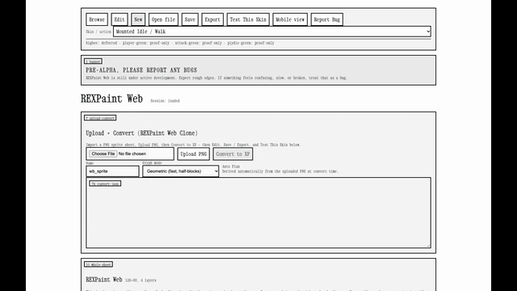

# Asciicker XPEdit ( PRE-ALPHA, PLEASE REPORT ANY BUGS )

Greenfield rebuild of main sprite-sheet pipeline features currently still broken in the main Asciicker-Y9-2 Fork. This repo is intentionally independent of the main Asciicker and Asciicker-Y9-2 Fork codebase. This is a browser-based XP sprite editor and functional alternative to the Windows-only REXPaint Editor, adapted specifically for the Asciicker Game Engine. Features include: convert PNG sprite sheets to `.xp` files, edit cells in a whole-sheet editor with true REXPaint parity, and test skins live in the game engine. More features to come, please report any bugs or complaints.

## Demo

Upload PNG sprite sheet → Convert/slice → XP Preview animation → Test This Skin running in the game world:



Recorded end-to-end with `scripts/wb-full-skin-run.mjs` (Playwright + CDP screencast). Source MP4 and step screenshots: `artifacts/wb-skin-run-3s/` (untracked build output).

## Run

```bash
python3 -m venv .venv
source .venv/bin/activate
pip install -e .
PYTHONPATH=src python3 -m pipeline_v2.app
```

Open:

- Live: `https://rikiworld.com/xpedit`
- Local (default): `http://127.0.0.1:5071/` (redirects to `/workbench`)
- Local (direct): `http://127.0.0.1:5071/workbench`

## Production deployment

The live editor runs on Google Cloud Run service `asciicker-xpedit` in
`yuzu-agent` / `us-central1`. A Cloudflare Worker routes
[`rikiworld.com/xpedit`](https://rikiworld.com/xpedit) to that service.
The editor is not deployed by GitHub Pages.

Push changes to `main`, then manually run **Deploy to Cloud Run**. A push alone
does not deploy the endpoint. Deploy an exact commit with:

```bash
gh workflow run deploy-cloudrun.yml \
  --repo rikiyanai/rexpaint-asciicker-workbench-v3 \
  --ref main -f target_ref="$(git rev-parse HEAD)"
```

The workflow runs tests, builds a commit-tagged container, deploys it, and runs
health and upload checks. The repository requires a
`GCP_WORKLOAD_IDENTITY_PROVIDER` Actions secret and Google Cloud trust for this
repository; secrets and trust from `rikiyanai/asciicker-xpedit` do not transfer
automatically. See [deployment setup and verification](deploy/README.md).

Cloud Run storage is ephemeral: a deployment or restart discards uploaded files
and editor sessions. Export work before deploying.

## Required Inputs

- `image_file` (`.png`)
- `name` (string)
- `angles` (int >= 1)
- `frames` (CSV like `8,8,8,8`)
- `source_projs` (`1|2`, default `1`)
- `render_resolution` (int, default `24`)
- `bg_mode` (`key_color|alpha|none`, default `key_color`)
- `bg_tolerance` (int, default `8`)

## Required Outputs

- `.xp` file path
- preview PNG path
- run report JSON
- gates JSON with G7/G8/G9
- workbench session with `populated_cells > 0`
- exported `.xp` from workbench

## API

- `POST /api/upload`
- `POST /api/analyze`
- `POST /api/run`
- `GET /api/status/<job_id>`
- `POST /api/workbench/load-from-job`
- `POST /api/workbench/export-xp`

All failures return:

```json
{
  "error": "human readable",
  "code": "machine_code",
  "stage": "upload|analyze|run|workbench",
  "request_id": "uuid"
}
```

## Tests

```bash
PYTHONPATH=src python3 -m pytest
```

## Notes

- The XP codec implemented here writes/reads classic REXPaint-style layers.
- This MVP uses deterministic grayscale glyph mapping; it is not final art-quality conversion.

## Docs

- Reference spec (pipeline-v3 subproject scope only): `docs/plans/2026-03-23-workbench-canonical-spec.md`
- Failure log: [docs/PLAYWRIGHT_FAILURE_LOG.md](docs/PLAYWRIGHT_FAILURE_LOG.md)
